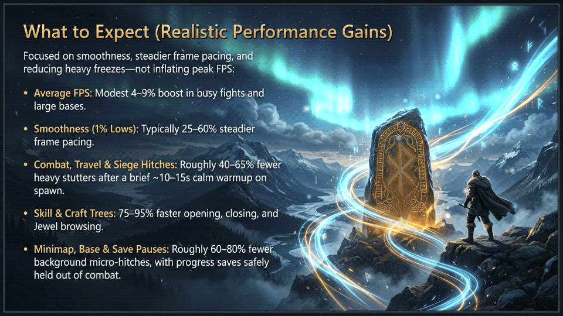
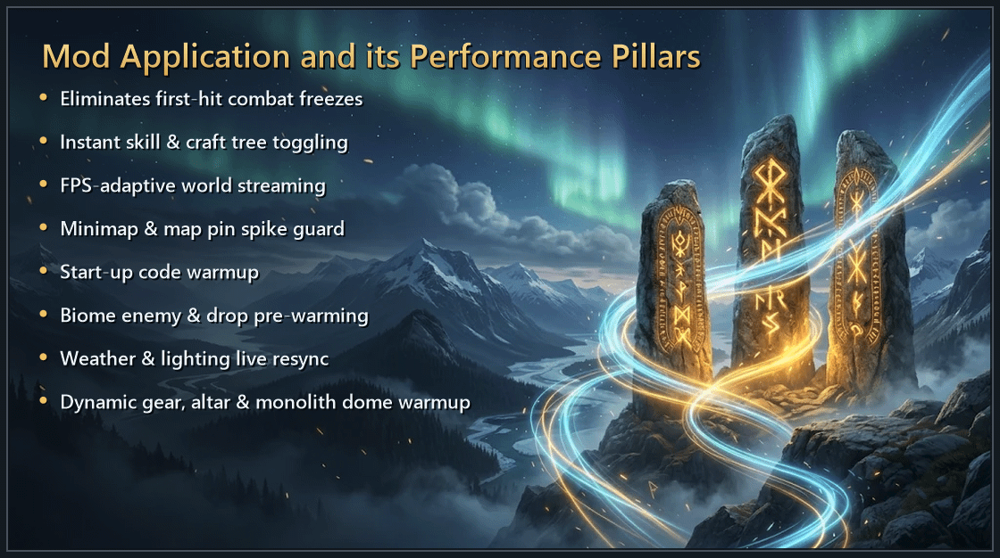

<!-- POV_SLIDES_START -->

---
<!-- POV_SLIDES_END -->

# Path of Valheiman Performance Boosts

> **100% Pure Performance — Zero Gameplay Changes**
>
> Never alters Path of Valheiman's balance, skill trees, combat math, drop rates, recipes, or design. Works purely behind the scenes for smoother solo and multiplayer play, automatically scaling from 30fps Potato-esque laptops to 165fps Ferrari-esque desktops. Safe to add or remove at any time without affecting saves.

---

*(See the **Changelog** tab for full `v2.1.0` release notes.)*

### Combat & First-Hit Smoothness

- **Main-Menu Warmup**
  - *Problem:* Heavy combat, crafting, Equipment & Gem UI, Monolith, Halls, and menu systems normally set themselves up the first time you trigger them in-world, causing sharp first-hit and first-open hitches.
  - *Solution:* Prepares those systems in the background on the title screen for crisper first fights and smoother first-time inventory opens.
- **Load-Time-Friendly Pre-Warming**
  - *Problem:* Loading visuals and effects for Path of Valheiman's custom gear, summons, and enemies on first encounter causes sudden micro-stutters—while loading everything upfront drags out world load times.
  - *Solution:* Automatically discovers Path of Valheiman's live weapons, summon staves, essences, bombs, and uniques, warming equipped and hotbar gear plus current-biome enemies, Monolith visuals, and static equipment/gem icons in small calm-frame steps to protect load times.
- **Skip Unused Combat Checks**
  - *Problem:* During combat, Path of Valheiman repeatedly checks rules for weapon types, classes, and passives your character isn't even using, adding steady CPU overhead on every swing and hit.
  - *Solution:* Pauses checks for weapon types, classes, and passives outside your active build, updating instantly whenever you swap gear or respec.
- **Multi-Shot & AoE Efficiency**
  - *Problem:* Multi-projectile volleys repeat identical weapon lookups for every arrow or bolt, and dense AoE fights can stack dozens of identical cosmetic hit effects on the exact same frame.
  - *Solution:* Reuses identical weapon lookups within multi-projectile volleys and caps stacked duplicate cosmetic hit effects in dense AoE fights without ever skipping damage or physics.

### Smoother Endgame Halls

- **Distant-Room Visual Culling**
  - *Problem:* In large multi-room Halls, the game keeps drawing distant rooms far down the dungeon even when they are completely blocked by stone walls. As you push deeper into a run, rendering dozens of unseen rooms at once can cause heavy, sustained framerate drops during big fights.
  - *Solution:* Temporarily hides visuals on far-away rooms (well beyond your current room and connecting corridors, so nothing pops in) and restores them smoothly as you approach. All room layouts, collisions, enemies, and loot stay completely untouched while delivering noticeably steadier framerates across long runs.
- **Stopped Wasted Overworld Activity & Biome Noise Beneath Halls**
  - *Problem:* Endgame Halls float high in the sky, yet Valheim's surface spawner, world loader, and biome scanner only check your horizontal map position—not your height. While you fight inside a Hall, the game keeps spawning overworld creatures, loading surface dungeons, logging once-per-second biome warnings, popping false overworld biome banners (like "Ocean"), flickering music, and triggering unnecessary surface pre-warming.
  - *Solution:* Pauses surface creature spawns, surface dungeon reloads, overworld churn, and surface biome checks directly beneath sky-high Halls while you are inside—staying multiplayer-safe so teammates on the surface keep normal spawns and world loading, and resuming surface checks the instant you leave.
- **Cleaner Hall Launches, Saves & Gate Audio**
  - *Problem:* Launching a Hall map right after packing it can trigger overlapping world saves that stall entry, mid-fight progress saves can hitch intense rooms, and inactive Hall gates repeatedly log harmless audio warnings in the background.
  - *Solution:* Waits for any active pack save to finish before starting the launch save, holds non-critical progress saves until combat rooms settle (always saving immediately on death, logout, or exit), and silences disabled Hall gate audio spam.

### Smoother Monoliths

- **Arena Clearing & Idols**
  - *Problem:* Clearing a Monolith arena and placing idols can fire bursts of cleanup and world updates on a single frame, causing noticeable freezes right as an encounter starts or finishes.
  - *Solution:* Spreads Monolith arena clearing across frames and batches idol placement updates cleanly across every biome.
- **Siege-Time Protection**
  - *Problem:* Moving around during a chaotic Monolith siege can trigger distant off-screen dungeon loads and unexplored zone generation mid-fight.
  - *Solution:* Holds distant off-screen dungeon loads and far-away unexplored zones during active Monolith sieges while keeping your immediate area and multiplayer teammates' areas unaffected.

### Exploration & Dungeons

- **Exploration & Dungeon Pacing**
  - *Problem:* Sprinting or sailing into unexplored areas can build heavy dungeons and fortresses back-to-back, while crossing near a dungeon's zone border can repeatedly tear down and reload its interior.
  - *Solution:* Spaces out heavy unexplored dungeon and fortress builds, loads distant dungeon rooms smoothly across frames with breathing room after large halls, and keeps nearby dungeons stable across zone borders.
- **Smooth World Loading & Water Refresh**
  - *Problem:* Streaming too many nearby objects at once, overlapping load and cleanup work on the same frame, and constantly re-rendering water depth even while standing still can make traversal feel choppy.
  - *Solution:* Adapts nearby object streaming to live framerate headroom, separates loading and cleanup frames in solo play, and refreshes water depth only when you move or reshape terrain.

### Menus, Stability & Background Pacing

- **Fluid Passive Tree, Craft Tree, Equipment & Jewel UI**
  - *Problem:* Opening, zooming, or socketing Jewels in Path of Valheiman's large trees forces heavy UI layers to redraw together, and first-time Equipment opens decode static slot graphics on the spot.
  - *Solution:* Separates dynamic overlays and Jewel layers from the main tree for noticeably smoother opens, zooming, and Jewel socketing, and gently prepares static Equipment & Gem icons on calm frames (automatically standing down when an external equipment UI mod is active).
- **Smarter Saves & Minimap**
  - *Problem:* Non-critical progress saves firing mid-fight and sudden minimap pin rebuilds can freeze the screen during active gameplay.
  - *Solution:* Holds non-critical progress saves until active combat settles (always saving immediately on death, logout, or exit) and reduces minimap pin rebuild stutters.
- **Valheim `1.0.30 – 1.0.31` Cleanups, Overlap Safety & Startup Status**
  - *Problem:* Redundant snow checks outside Deep North, harmless log spam, stacked background timers, solo multiplayer checks, and silent mod overlaps waste frame time or cause hard-to-spot conflicts in larger modpacks.
  - *Solution:* Aligns with `1.0.30+` memory cleanup, skips unnecessary Deep North snow checks in other biomes, silences harmless Deep North log spam, spreads background timers, pauses multiplayer-only checks during solo play, and prints a Main Menu status line confirming active boosts (or any feature that automatically yielded to another mod).

---

## Requirements

- **Valheim** `1.0.30 – 1.0.31`
- **BepInExPack Valheim** (`5.4.2360` or compatible)
- **Path of Valheiman** (`6.0.10 – 6.0.16`, verified with **Jötunn** `2.30.3`)
- Client-side only — works in both **solo** and **multiplayer** with no server install required.

---

## Configuration

Works out of the box with zero setup. Adjust any option in **Gale Mod Manager's Config Editor**, an in-game **Configuration Manager**, or `BepInEx/config/robin.valheim.pov_performance_boosts.cfg`:

1. **01. General** — Master toggle, update safety guard, and **Auto-Yield on Mod Overlap** (On by default; automatically detects mod overlaps once on Main Menu load, steps aside only conflicting features, and reports the result in a concise light-blue console status line).
2. **02. Combat & World Warmups** — Main-menu warmup, gear/biome pre-warming, Monolith visuals, altars, combat text, and sounds.
3. **03. Combat Efficiency** — Unused skill/weapon skipping, multi-shot reuse, and cosmetic hit-effect limiter.
4. **04. UI, World & Background Pacing** — Exploration and dungeon pacing, Hall visual culling and surface guard, Passive Tree and minimap smoothing, world loading, water refresh, save pacing, memory cleanup tuning, and solo stand-down.
5. **05. ValheimAVX Cooperation (Requires ValheimAVX)** — Temporarily paused since `v2.0.0` (visible and **Off** by default with a status note).
6. **06. Diagnostics (Advanced)** — Opt-in combat and non-combat stutter loggers (**Off** by default with zero overhead).

---

## ValheimAVX Status

**Temporarily Stepping Away from ValheimAVX Co-op Features: Active ValheimAVX cooperation toggles are temporarily paused since v2.0.0 (the config category remains visible, with a status note).**

- ValheimAVX is optional and not required.
- Because ValheimAVX relies on deep, low-level engine modifications that can be disrupted by game patches, Section 05 stays in place (Off by default) so cooperation can return cleanly if ValheimAVX stabilizes on Valheim `1.0.30+`.

---

## Compatibility & Troubleshooting

- **Safe with Base & Chest Mods:** Never touches chests, item drawers, smelters, or crafting-from-containers mods.
- **Reporting a Stutter:** Enable **Log Combat Stutters** or **Log Non-Combat Stutters** in **06. Diagnostics (Advanced)**, restart Valheim, reproduce the hitch, and check `BepInEx/LogOutput.log`. Turn both back **Off** afterward for zero-overhead play.
