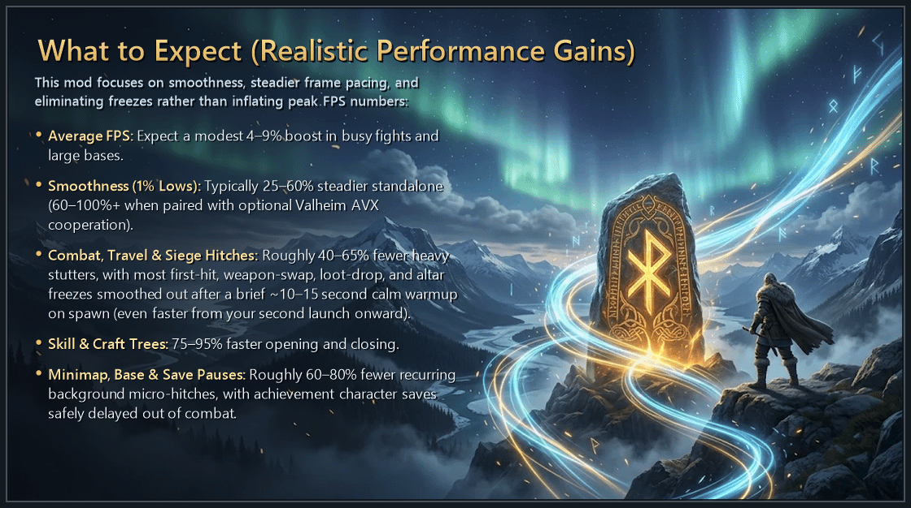

<!-- POV_SLIDES_START -->

---
<!-- POV_SLIDES_END -->

# Path of Valheiman Performance Boosts

> **100% Pure Performance — Zero Gameplay Changes**
>
> Never alters Path of Valheiman's balance, skill trees, combat math, drop rates, recipes, or design. Works purely behind the scenes for smoother solo and multiplayer play, automatically scaling from laptops to high-refresh desktops. Safe to add or remove at any time without affecting saves.

---

### Combat & First-Hit Smoothness

- **Main-Menu Warmup** — Prepares heavy combat, crafting, Monolith, Halls, and menu code on the title screen for crisper first fights and menu opens.
- **Load-Time-Friendly Pre-Warming** — Automatically discovers Path of Valheiman's live weapons, summon staves, essences, bombs, and uniques, warming equipped and hotbar gear plus current-biome enemies and Monolith visuals in small calm-frame steps to protect load times.
- **Skip Unused Combat Checks** — Pauses Path of Valheiman checks for weapon types, classes, and passives your build isn't using, updating instantly on gear swap or respec.
- **Multi-Shot & AoE Efficiency** — Reuses identical weapon lookups within multi-projectile volleys and caps stacked duplicate cosmetic hit effects in dense AoE fights without ever skipping damage or physics.

### Smoother Endgame Halls

- **Distant-Room Visual Culling**
  - *Problem:* In large multi-room Halls, the game keeps drawing distant rooms far down the dungeon even when they are completely blocked by stone walls. As you push deeper into a run, rendering dozens of unseen rooms at once can cause heavy, sustained framerate drops during big fights.
  - *Solution:* Temporarily hides visuals on far-away rooms (well beyond your current room and connecting corridors, so nothing pops in) and restores them smoothly as you approach. All room layouts, collisions, enemies, and loot stay completely untouched while delivering noticeably steadier framerates across long runs.
- **Stopped Wasted Overworld Activity Beneath Halls**
  - *Problem:* Endgame Halls float high in the sky, yet Valheim's surface spawner and world loader only check your horizontal map position—not your height. While you fight inside a Hall, the game keeps spawning overworld creatures, loading surface dungeons, and building terrain far below you in areas you cannot even reach.
  - *Solution:* Pauses surface creature spawns, surface dungeon reloads, and overworld churn directly beneath sky-high Halls while you are inside—staying multiplayer-safe so teammates on the surface continue playing with normal spawns and world loading.
- **Cleaner Hall Launches, Saves & Gate Audio**
  - *Problem:* Launching a Hall map right after packing it can trigger overlapping world saves that stall entry, mid-fight progress saves can hitch intense rooms, and inactive Hall gates repeatedly log harmless audio warnings in the background.
  - *Solution:* Waits for any active pack save to finish before starting the launch save, holds non-critical progress saves until combat rooms settle (always saving immediately on death, logout, or exit), and silences disabled Hall gate audio spam.

### Smoother Monoliths

- **Arena Clearing & Idols** — Spreads Monolith arena clearing across frames and batches idol placement updates cleanly across every biome.
- **Siege-Time Protection** — Holds distant off-screen dungeon loads and far-away unexplored zones during active Monolith sieges while keeping your immediate area and multiplayer teammates' areas unaffected.

### Exploration & Dungeons

- **Exploration & Dungeon Pacing** — Spaces out heavy unexplored dungeon and fortress builds, loads distant dungeon rooms smoothly across frames with breathing room after large halls, and keeps nearby dungeons stable across zone borders.
- **Smooth World Loading & Water Refresh** — Adapts nearby object streaming to live framerate headroom, separates loading and cleanup frames in solo play, and refreshes water depth only when you move or reshape terrain.

### Menus, Stability & Background Pacing

- **Fluid Passive Tree, Craft Tree & Jewel UI** — Separates dynamic overlays and Jewel layers from the main tree for noticeably smoother opens, zooming, and Jewel socketing, with zero cost while closed.
- **Smarter Saves & Minimap** — Holds non-critical progress saves until active combat settles (always saving immediately on death, logout, or exit) and reduces minimap pin rebuild stutters.
- **Valheim `1.0.30` Cleanups & Background Pacing** — Aligns with `1.0.30`'s memory cleanup, skips unnecessary Deep North snow checks in other biomes, silences harmless Deep North log spam, spreads background timers, and pauses multiplayer-only checks during solo play.

*(See the **Changelog** tab for full `v2.0.0` release notes.)*

---

## Requirements

- **Valheim** `1.0.30`
- **BepInExPack Valheim** (`5.4.2360` or compatible)
- **Path of Valheiman** (`6.0.10 – 6.0.16`)
- Client-side only — works in both **solo** and **multiplayer** with no server install required.

---

## Configuration

Works out of the box with zero setup. Adjust any option in **Gale Mod Manager's Config Editor**, an in-game **Configuration Manager**, or `BepInEx/config/robin.valheim.pov_performance_boosts.cfg`:

1. **01. General** — Master toggle and update safety guard.
2. **02. Combat & World Warmups** — Main-menu warmup, gear/biome pre-warming, Monolith visuals, altars, combat text, and sounds.
3. **03. Combat Efficiency** — Unused skill/weapon skipping, multi-shot reuse, and cosmetic hit-effect limiter.
4. **04. UI, World & Background Pacing** — Exploration and dungeon pacing, Hall visual culling and surface guard, Passive Tree and minimap smoothing, world loading, water refresh, save pacing, memory cleanup tuning, and solo stand-down.
5. **05. Valheim AVX Cooperation (Requires Valheim AVX)** — Temporarily paused in `v2.0.0` (visible and **Off** by default with a status note).
6. **06. Diagnostics (Advanced)** — Opt-in combat and non-combat stutter loggers (**Off** by default with zero overhead).

---

## ValheimAVX Status (`v2.0.0`)

**Temporarily Stepping Away from ValheimAVX Co-op Features: Active ValheimAVX cooperation toggles are temporarily paused in v2.0.0 (the config category remains visible, with a status note).**

- ValheimAVX is optional and not required.
- Because ValheimAVX relies on deep, low-level engine modifications that can be disrupted by game patches, Section 05 stays in place (Off by default) so cooperation can return cleanly if ValheimAVX stabilizes on Valheim `1.0.30+`.

---

## Compatibility & Troubleshooting

- **Safe with Base & Chest Mods:** Never touches chests, item drawers, smelters, or crafting-from-containers mods.
- **Reporting a Stutter:** Enable **Log Combat Stutters** or **Log Non-Combat Stutters** in **06. Diagnostics (Advanced)**, restart Valheim, reproduce the hitch, and check `BepInEx/LogOutput.log`. Turn both back **Off** afterward for zero-overhead play.